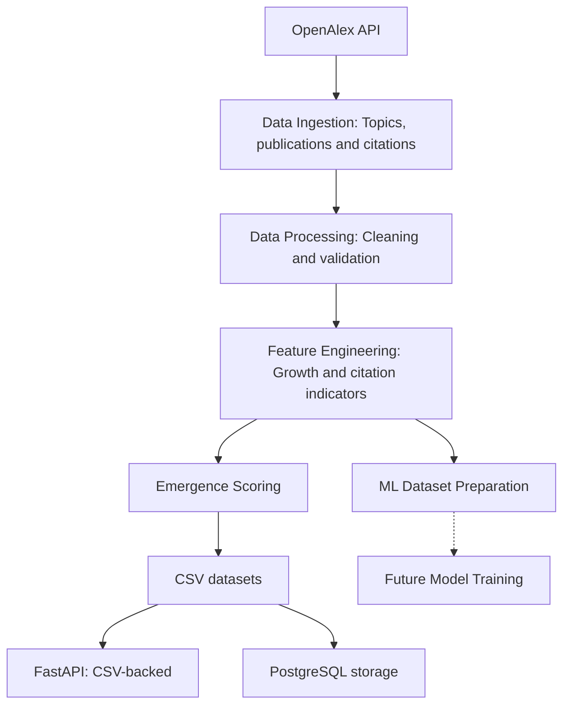
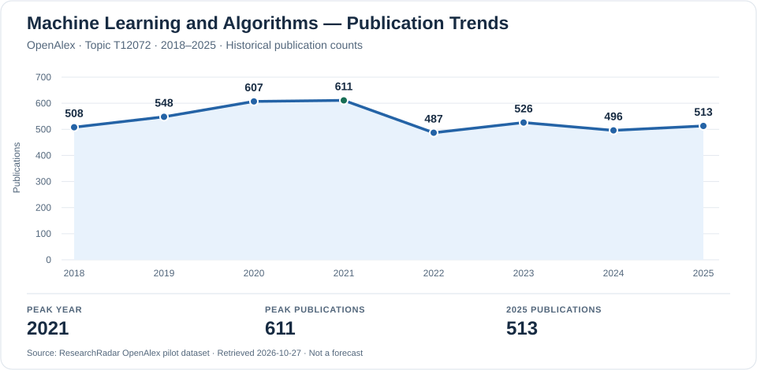
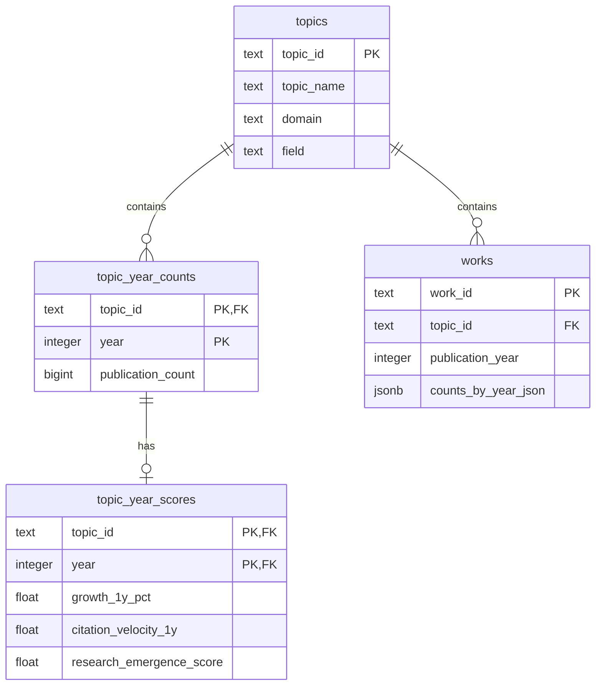
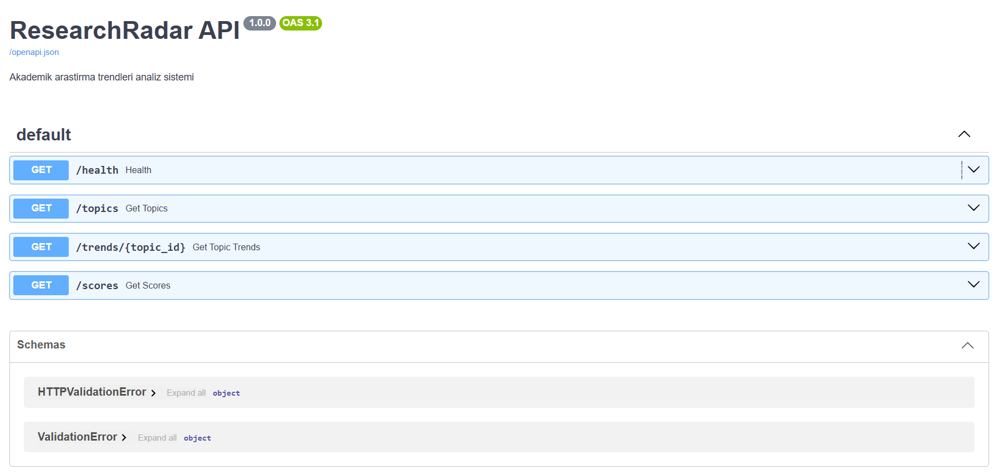

# ResearchRadar

**Research Trend Detection & Forecasting Platform**


## Project Overview

ResearchRadar is a data-driven research analytics platform designed to identify emerging academic research trends and prepare predictive machine learning datasets using publication growth, citation dynamics, and bibliometric indicators.

The project integrates academic data ingestion, data engineering, feature engineering, relational database management, research emergence scoring, and REST API development.

## Project Scale

| Indicator | Value |
|---|---:|
| Research topics | 500 |
| Unique academic publications | 119,229 |
| Topic-year records | 5,000 |
| Historical coverage | 2016–2025 |
| Research domains | 4 |
| Implemented API endpoints | 4 |

Dataset counts are documented in the project's [database documentation](database/README.md).

## Research Domain Coverage

| Domain | Topics |
|---|---:|
| Health Sciences | 125 |
| Life Sciences | 125 |
| Physical Sciences | 125 |
| Social Sciences | 125 |

Balanced topic selection across four academic domains.

## Key Features

- **Academic Data Ingestion:** OpenAlex API integration and structured data collection.
- **Data Engineering:** Data cleaning, deduplication, validation, and dataset integration.
- **Bibliometric Analysis:** Publication growth and citation dynamics.
- **Feature Engineering:** Historical growth, acceleration, stability, and citation velocity.
- **Research Emergence Score:** Domain-relative ranking of emerging research topics.
- **Relational Database:** PostgreSQL schema, constraints, indexes, and UPSERT operations.
- **REST API:** FastAPI endpoints for topics, publication trends, and rankings.
- **ML Dataset Preparation:** Temporal splitting and next-year growth classification targets.
- **Automated Testing:** Nine implemented API test cases.

## System Architecture



The current API reads CSV files. PostgreSQL integration is implemented as a separate data storage layer. Predictive model training remains a future development stage.

## Data Visualization

### Historical Publication Trends



This example shows historical publication counts for OpenAlex topic **T12072 (Machine Learning and Algorithms)**. The highest annual count was 611 in 2021; the 2025 count was 513. The visualization uses the project's [pilot dataset](data/samples/T12072_yearly_counts.csv), collected on October 27, 2026, and is not a forecasting result.

## Feature Engineering

| Feature | Description |
|---|---|
| growth_1y_pct | One-year publication growth |
| growth_2y_pct | Two-year publication growth |
| growth_3y_pct | Three-year publication growth |
| growth_acceleration | Change in annual growth |
| growth_stability | Rolling growth standard deviation |
| citation_sample_size | Number of sampled publications |
| citation_velocity_1y | Mean next-year citation count |
| citation_velocity_median | Median next-year citations |
| early_citation_mean | Mean early citation count |

## Research Emergence Score

A domain-relative scoring mechanism that combines publication growth and citation velocity using percentile rankings within each year and research domain.

```math
RES = 0.60G + 0.40C
```

Here, G is the publication growth percentile score and C is the citation velocity percentile score.

**Emerging candidate criteria**

- Emergence Score ≥ 75.
- Positive publication growth.
- Positive citation velocity.
- At least 10 sampled publications for score eligibility.

| Score coverage | Records |
|---|---:|
| Calculated scores | 3,488 |
| Unavailable scores | 1,512 |

Missing scores are stored as NULL rather than zero.

## Machine Learning Dataset

The forecasting component is designed to predict whether a research topic will experience positive next-year growth exceeding its domain's median growth by at least five percentage points.

| Dataset | Expected records |
|---|---:|
| Labeled ML records | 2,495 |
| Inference records | 499 |

These counts are expected by the dataset validation code.

### Temporal Validation Strategy

| Feature year | Split |
|---|---|
| 2020–2022 | Train |
| 2023 | Validation |
| 2024 | Test |
| 2025 | Inference |

Temporal splitting and future-information exclusion are designed to reduce data leakage in next-year prediction.

## PostgreSQL Database Architecture



Database features include primary and foreign keys, JSONB citation storage, validation queries, indexes, and idempotent data imports using UPSERT.

## REST API Endpoints

| Method | Endpoint | Description |
|---|---|---|
| GET | `/health` | API health check |
| GET | `/topics` | List 500 research topics |
| GET | `/trends/{topic_id}` | Historical publication counts and growth |
| GET | `/scores?year=2025&limit=10` | Ranked Research Emergence Scores |

### API Demo



Interactive FastAPI documentation providing access to research topics, historical publication trends, and Research Emergence Score rankings.

## Repository Structure

```text
research-radar/
├── assets/
│   ├── api-demo.png
│   └── publication-trends.svg
├── data/
│   └── samples/
├── database/
│   ├── schema.sql
│   ├── import_data.py
│   ├── import_works.py
│   ├── validation_queries.sql
│   └── README.md
├── src/
│   ├── api/
│   ├── ingestion/
│   ├── data_processing/
│   ├── features/
│   └── ml/
├── tests/
│   └── test_api.py
├── requirements.txt
├── requirements-dev.txt
├── .gitignore
└── README.md
```

## Installation & Usage

```bash
git clone https://github.com/blgmstf332/research-radar.git
cd research-radar
pip install -r requirements.txt
```

Launch the API:

```bash
uvicorn src.api.main:app --reload
```

Interactive API documentation: [http://127.0.0.1:8000/docs](http://127.0.0.1:8000/docs)

Run automated tests:

```bash
pip install -r requirements-dev.txt
python -m pytest
```

For PostgreSQL setup, data import, and validation, refer to [Database Documentation](database/README.md).

Full data ingestion requires an OpenAlex API key. Large publication datasets are not included in the public repository.

## Project Roadmap

- [x] OpenAlex data ingestion
- [x] Expansion from 120 to 500 research topics
- [x] Data cleaning and validation
- [x] Publication feature engineering
- [x] Citation feature engineering
- [x] Research Emergence Score
- [x] Temporal ML dataset preparation
- [x] PostgreSQL database infrastructure
- [x] FastAPI backend
- [x] Automated API test implementation
- [ ] Predictive model training and comparison
- [ ] Independent model evaluation
- [ ] PostgreSQL-backed API integration
- [ ] Interactive analytics dashboard
- [ ] Deployment

## Limitations & Future Improvements

- Train and evaluate predictive machine learning models.
- Assess topic sampling and citation coverage biases.
- Validate the emergence scoring methodology.
- Integrate PostgreSQL directly with the API.
- Improve data pipeline automation and reproducibility.
- Develop an interactive research analytics dashboard.

## Data Source

[OpenAlex](https://openalex.org/) — Open scholarly metadata and research information.

## Author

**Mustafa Kılıç**

Computer Engineering Student — Artificial Intelligence, Machine Learning & Data Science

[GitHub](https://github.com/blgmstf332)
